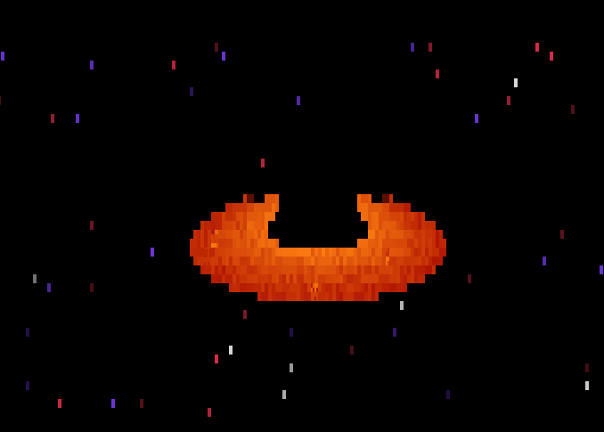

# Noir Hole



**Noir Hole** is a lightweight black-hole renderer written in Rust. It runs directly in the terminal using truecolor ANSI output and renders an animated accretion disk, event horizon, starfield, and approximate gravitational lensing.

## Features

- Curved ray paths for real-time gravitational-lensing effects
- Dark event horizon with depth ordering
- Animated orange-red accretion disk
- Twinkling procedural starfield
- Mouse-controlled camera orbit
- Keyboard and mouse-wheel zoom
- 2×2 terminal-cell compositor for smoother output
- Buffered terminal output and adaptive ray marching
- Small, optimized release binary

## Requirements

- Rust stable with Cargo
- A terminal supporting ANSI truecolor and Unicode block characters
- A terminal size of at least a few rows and columns

## Run

```bash
cargo run --release
```

Build the optimized executable without running it:

```bash
cargo build --release
./target/release/noir_hole
```

## Controls

| Input | Action |
| --- | --- |
| Left-mouse drag | Orbit the camera |
| Mouse wheel up / `+` / `=` / `↑` | Zoom in |
| Mouse wheel down / `-` / `↓` | Zoom out |
| `q` or `Esc` | Quit |

## Project layout

```text
src/
├── app.rs                 # Application loop and frame timing
├── camera.rs              # Camera state and ray generation
├── input.rs               # Keyboard and mouse handling
├── math/
│   └── vec3.rs            # 3D vector operations
├── renderer/
│   ├── geometry.rs        # Analytic geometry helpers
│   ├── mod.rs             # Ray-tracing pipeline and shading
│   ├── ray.rs             # Ray representation
│   ├── scene.rs           # Scene constants
│   └── shading.rs         # Pixel representation
└── terminal/
    └── display.rs         # ANSI terminal compositor
```

## Performance

The renderer uses cached camera bases, adaptive ray-march steps, early ray rejection, buffered terminal writes, and a 30 FPS frame cap. Release builds also use LTO, stripped symbols, a single codegen unit, and `panic = "abort"`.

The lensing model is an efficient visual approximation of curved null-ray paths rather than a full general-relativity simulation. It is designed to remain responsive in a terminal while retaining the characteristic warped disk and dark-hole silhouette.

## License

No license has been selected yet. Add one before distributing the project publicly.
